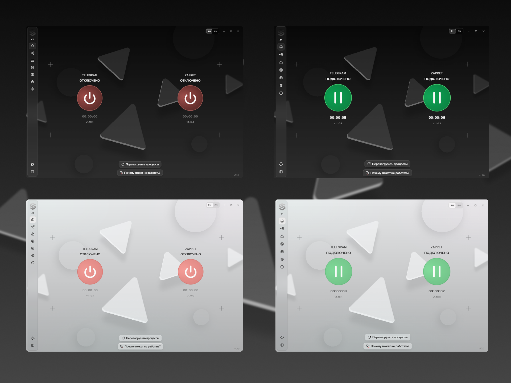

<p align="center">
  
</p>

<h1 align="center">Slipgate</h1>

<p align="center">
  <strong>Telegram и Zapret. Всё под вашим контролем.</strong><br />
  Приложение для Windows, которое объединяет локальный Telegram WS-прокси,<br />
  обход DPI, подбор стратегий и управление списками в одном интерфейсе.
</p>

<p align="center">
  
  
  
  <a href="./LICENSE"></a>
</p>

<p align="center">
  <a href="https://github.com/tenstepsbeforedecay/Slipgate/releases/latest"><strong>Скачать для Windows</strong></a>
  &nbsp; · &nbsp;
  <a href="https://t.me/slipgate_support_bot"><strong>Связаться в Telegram</strong></a>
</p>

> [!TIP]
>
> ### Поддержать проект
>
> Если вам понравилось приложение, вы можете поддержать его дальнейшую разработку.
>
> Спасибо за поддержку!
>
> **USDT · TRC20**<br />
> `TDSdGFTK8GDq8gtaQSpVSyb5bxEyuj36cb`
>
> **USDT · ERC20**<br />
> `0xF11c0f2b7628b03Ec323D6d431d0Bb00cf5f2c38`
>
> **USDT · BEP20**<br />
> `0xF11c0f2b7628b03Ec323D6d431d0Bb00cf5f2c38`

---

> [!NOTE]
>
> **Отдельное большое спасибо [Flowseal](https://github.com/flowseal)** за разработку и поддержку [TG WS Proxy](https://github.com/Flowseal/tg-ws-proxy) и развитие проекта [zapret-discord-youtube](https://github.com/Flowseal/zapret-discord-youtube): стратегий обхода DPI, сценариев запуска и инструментов настройки для Windows.
>
> Эти проекты лежат в основе сетевых возможностей Slipgate. Спасибо за открытый код, постоянную работу над инструментами обхода блокировок и вклад в свободный доступ к интернету.

<p align="center">
  <a href="#about">О приложении</a> ·
  <a href="#telegram">Telegram</a> ·
  <a href="#zapret">Zapret</a> ·
  <a href="#lists">Списки сообщества</a> ·
  <a href="#updates">Обновления</a><br />
  <a href="#settings">Настройки</a> ·
  <a href="#diagnostics">Диагностика</a> ·
  <a href="#start">Первый запуск</a> ·
  <a href="#development">Разработка</a>
</p>

<a id="about"></a>

## О приложении

**Slipgate** помогает управлять двумя независимыми сетевыми инструментами: **Telegram WS-прокси** и **Zapret**. Первый обеспечивает подключение Telegram через локальный прокси, второй применяет стратегии обхода DPI для сайтов, приложений и игр.

Каждый компонент можно включить отдельно. Slipgate управляет их запуском и остановкой, показывает состояние, сохраняет настройки и позволяет обновлять компоненты из интерфейса.

<p align="center">
  
</p>

| Возможность                | Что даёт                                                                                       |
| :------------------------- | :--------------------------------------------------------------------------------------------- |
| **Telegram WS-прокси**     | Подключение Telegram по готовой ссылке, собственный ключ и поддержка своего Cloudflare Worker. |
| **Обход DPI**              | Управление стратегиями Zapret для YouTube, Discord и других сервисов.                          |
| **Тестирование стратегий** | Сравнение доступности сервисов, скорости и задержки в вашей сети.                              |
| **Редактор списков**       | Работа с доменами, IP-адресами, диапазонами и исключениями без ручного поиска файлов.          |
| **Списки сообщества**      | Поиск, просмотр, установка и публикация готовых списков.                                       |
| **Обновления**             | Проверка новых версий Slipgate и выбор версий сетевых компонентов.                             |
| **Диагностика и логи**     | Пояснения к проблемам запуска, поиск событий и экспорт журнала.                                |
| **Работа в фоне**          | Трей, тихий старт и раздельный автозапуск приложения и компонентов.                            |

> Эффективность обхода зависит от провайдера, сети и выбранной стратегии. Zapret не создаёт VPN-туннель и не меняет ваш публичный IP.

<a id="telegram"></a>

## Telegram WS-прокси

Встроенный **TgWsProxy** принимает локальные MTProto-подключения и передаёт их через WebSocket. Для использования достаточно включить компонент и добавить предложенный прокси в Telegram Desktop или совместимый клиент.

### Подключение

- **«Открыть в Telegram»** передаёт ссылку подключения в клиент.
- **Копирование ссылки** позволяет добавить прокси вручную.
- **Показ и скрытие ссылки** помогают не раскрывать параметры подключения на экране.
- **Смена ключа** создаёт новый секрет и обновляет ссылку. После этого нужно заново добавить подключение в Telegram.

### Параметры прокси

| Параметр                   | Назначение                                                                                                             |
| :------------------------- | :--------------------------------------------------------------------------------------------------------------------- |
| **Хост**                   | Адрес, используемый для подключения к локальному прокси.                                                               |
| **Порт**                   | Порт прокси; допустимое значение — от 1 до 65535.                                                                      |
| **Секретный ключ**         | Ключ MTProto из 32 шестнадцатеричных символов. Можно использовать свой или создать новый в приложении.                 |
| **Свой Cloudflare Worker** | Дополнительный маршрут через ваш Worker. Вводится домен без `https://` и пути; требуется совместимая версия TgWsProxy. |

Slipgate проверяет введённые значения и сообщает, когда для применения нужен перезапуск прокси. Если изменились хост, порт или ключ, ссылку в Telegram также нужно обновить.

Адрес Worker и ключ сохраняются между запусками. При первом запуске новой установки создаётся случайный ключ Telegram.

<a id="zapret"></a>

## Zapret — обход DPI

Slipgate запускает стратегии на основе **winws** и **WinDivert**. Стратегия определяет, какой трафик обрабатывается и какие способы обхода применяются. Выбранный вариант сохраняется в настройках.

На странице **Zapret** доступны выбор стратегии, тестирование сети, редактор списков, режим IPSet и дополнительные параметры обхода.

### Как работает тестирование

1. **Проверка без обхода.** Приложение определяет, какие цели доступны в вашей сети до применения стратегий.
2. **Проверка стратегий.** Сравнивает доступность сервисов, задержку и скорость; учитывает ухудшение работы целей, доступных без обхода.
3. **Перепроверка лидеров.** Повторяет измерения лучших вариантов, чтобы уменьшить влияние случайных результатов.
4. **Итог.** Показывает рабочие стратегии, лучший вариант или несколько близких лидеров. Подробности по сервисам доступны рядом со стратегией.

Проверки охватывают **YouTube, Discord, Telegram, сайты, QUIC и голосовые соединения**. Результат помогает выбрать стратегию именно для текущей сети.

Тест можно отменить и **продолжить позже**, в том числе после перезапуска приложения. Если сеть, версия или параметры изменились и прежние результаты уже несовместимы, Slipgate начинает новый проход. После завершения доступно повторное тестирование.

Для показательных результатов отключите VPN, прокси и другие средства обхода. При обнаружении VPN-туннеля приложение предупреждает, что измерения описывают работу через него.

### Редактор списков

Списки определяют домены и адреса, к которым применяются правила стратегии, а также исключения из обработки.

- **Добавление записей:** домены, IP-адреса и CIDR-диапазоны с проверкой формата и удалением дубликатов.
- **Редактирование:** выделение нескольких строк, удаление записей, очистка списка, отмена и повтор правок.
- **Импорт и экспорт:** загрузка `.txt` в выбранный список и сохранение списка в файл.
- **Бэкап:** возврат к состоянию до первой правки в текущей версии Zapret.
- **Заводское восстановление:** возврат списков к исходному содержимому используемой сборки.

**Импорт заменяет выбранный список.** Установка списков сообщества добавляет пригодные записи к существующим.

### Режимы IPSet

| Режим          | Как работает                                                                                                                   |
| :------------- | :----------------------------------------------------------------------------------------------------------------------------- |
| **Базовый**    | Использует базовый набор IP: адреса Telegram и ваши добавления. Правила по доменам сохраняются.                                |
| **Полный**     | Подключает полный IP-список из сборки Flowseal вместе с пользовательскими записями.                                            |
| **Все адреса** | Применяет IP-правила стратегии ко всем адресам на её портах, с учётом исключений. Может затрагивать уже работающие соединения. |

### Настройка обхода

**Игровой фильтр** расширяет обработку на дополнительные игровые порты. Доступны выключенный режим, TCP и UDP вместе, только TCP или только UDP — в зависимости от поддержки сборкой и стратегией.

**Фейки для Discord и игр** выбираются отдельно. Это пакеты, используемые стратегией для обхода DPI. Интерфейс объясняет, когда выбранный фейк не применяется: например, если стратегия не поддерживает сменные фейки или нужный файл отсутствует в установленной версии.

**Сброс настроек обхода** возвращает игровой фильтр и фейки к заводским значениям. Списки и выбранная стратегия при этом не меняются.

### Очистка кеша Discord

Кнопка **«Очистить кеш Discord»** помогает, когда после смены стратегии клиент продолжает испытывать проблемы с подключением. После подтверждения Slipgate закрывает Discord и очищает папки `Cache`, `Code Cache` и `GPUCache`. Затем Discord нужно запустить заново.

<a id="lists"></a>

## Списки сообщества

Встроенный браузер списков позволяет обмениваться наборами доменов и IP-адресов для Zapret.

### Найти и установить

- Поиск публикаций и сортировка по дате или скачиваниям.
- Предпросмотр содержимого, количества доменов и адресов.
- Установка всех списков из публикации или только выбранных.
- Добавление записей без дубликатов.
- Скачивание списков отдельными файлами.
- Перезапуск работающего Zapret после установки, чтобы применить записи. Если компонент выключен, они применятся при следующем запуске.

### Поделиться своим списком

Закрепите никнейм, выберите один или несколько `.txt`-файлов и опишите, с какими сайтами, играми или сервисами они помогают. **Каждая публикация проходит модерацию** перед появлением в ленте.

Никнейм можно изменить или освободить. Для неподходящих публикаций предусмотрена жалоба с выбором причины и комментарием.

<a id="updates"></a>

## Обновления и версии

Slipgate проверяет обновления **трёх компонентов**: самого приложения, TgWsProxy и Zapret.

| Что обновляется | Возможности                                                                                        |
| :-------------- | :------------------------------------------------------------------------------------------------- |
| **Slipgate**    | Уведомление о новой версии, описание релиза, загрузка с отображением прогресса и запуск установки. |
| **TgWsProxy**   | Просмотр доступных версий и установка выбранной сборки, включая возврат к предыдущей.              |
| **Zapret**      | Выбор версии набора стратегий, установка и перенос пользовательских записей списков.               |

Поле версии показывает **установленную сборку**, а кнопка установки — выбранную цель. Сам выбор другого номера ещё не меняет компонент.

Автоматическую проверку можно включить или отключить в настройках. Кнопка **«Проверить обновления»** работает независимо от этой настройки. При временных сетевых сбоях загрузчик повторяет попытки; перед установкой компонентов проверяется контрольная сумма SHA-256.

<a id="settings"></a>

## Интерфейс и работа в фоне

### Внешний вид

- **Светлая и тёмная темы** с единым оформлением страниц, меню, карточек и уведомлений.
- **Русский и английский языки** с переключением без перезапуска.
- **Сворачиваемая боковая панель** для быстрого перехода между разделами.
- **Контекстные подсказки**, объясняющие назначение и особенности настроек.
- **Аппаратное ускорение**, которое можно переключить с последующим перезапуском приложения.

### Запуск

| Настройка                         | Поведение                                                                           |
| :-------------------------------- | :---------------------------------------------------------------------------------- |
| **Запускать при входе в Windows** | Открывает Slipgate после входа в систему.                                           |
| **Тихий старт**                   | Запускает приложение без открытия основного окна. Требует включённой иконки в трее. |
| **Автозапуск Telegram**           | Включает прокси при запуске Slipgate.                                               |
| **Автозапуск Zapret**             | Включает обход при запуске Slipgate. Требует заранее выбранной стратегии.           |

### Трей и панель задач

Поведение кнопки закрытия зависит от настроек:

| Иконка в трее | Скрытие с панели задач | Что происходит при закрытии окна                                    |
| :------------ | :--------------------- | :------------------------------------------------------------------ |
| Включена      | Включено               | Окно скрывается в трей; компоненты продолжают работать.             |
| Включена      | Выключено              | Окно сворачивается на панель задач; компоненты продолжают работать. |
| Выключена     | Недоступно             | Slipgate завершает работу.                                          |

Окно можно вернуть щелчком по иконке в трее. Для полного выхода при включённом трее выберите **«Выйти из Slipgate»** в его меню.

Отрисовка скрытого окна ограничивается. Когда настройки позволяют, интерфейс освобождается после простоя и восстанавливается при следующем открытии.

### Сброс настроек

**«Сбросить настройки»** возвращает параметры приложения и обхода к заводским значениям, останавливает компоненты и очищает результаты тестирования.

При этом сохраняются **ID установки, никнейм, списки Zapret, адрес Worker, ссылка Telegram и ключ**. После успешного сброса приложение перезапускается.

<a id="diagnostics"></a>

## Диагностика и журнал событий

Кнопка **«Почему может не работать?»** на главной странице открывает диагностику. Slipgate проверяет условия запуска и показывает инструкции для обнаруженных проблем Windows, прав администратора, компонентов и сетевых конфликтов. После выполнения рекомендаций можно запустить повторную проверку.

Если Windows не позволяет повысить права, приложение показывает причину и дальнейшие действия.

На странице **«Логи»** доступны:

- события Telegram, Zapret и самого приложения;
- фильтрация по источнику и поиск по тексту;
- счётчик проблем;
- очистка отображаемого журнала;
- сохранение логов в файл для разбора ошибки.

Если нужна помощь, напишите в [Telegram-бот](https://web.telegram.org/k/#@slipgate_support_bot). Укажите версии Slipgate и Windows, используемый компонент и шаги воспроизведения. Перед отправкой логов проверьте их на личные данные.

<a id="start"></a>

## Установка и первый запуск

**Требования:** Windows 10 или Windows 11, архитектура **x64**, возможность подтвердить запрос прав администратора. Повышенные права нужны для WinDivert и системных операций приложения.

1. Скачайте **`Slipgate_x64.exe`** со страницы [последнего опубликованного релиза](https://github.com/tenstepsbeforedecay/Slipgate/releases/latest).
2. Запустите установщик, выберите папку и откройте Slipgate.
3. Для **Telegram** включите прокси и нажмите **«Открыть в Telegram»**, затем подтвердите подключение в клиенте.
4. Для **Zapret** запустите тест стратегий без VPN, выберите подходящий вариант и включите компонент.
5. При необходимости настройте автозапуск, тему и работу в трее.

Официальная сборка распространяется как **NSIS-установщик для Windows**. Portable-архивы, macOS и Linux для текущей версии не выпускаются.

<a id="data"></a>

## Настройки и данные

Профиль обычной установки находится в **`%LOCALAPPDATA%\Slipgate`**. Основные настройки сохраняются в **`config.yaml`**, включая параметры Telegram и адрес Worker. Не публикуйте этот файл целиком: в нём есть секретный ключ прокси.

Отчёты тестирования хранятся локально с защитой Windows DPAPI. Учётные данные установки находятся в отдельном зашифрованном хранилище.

Для обновлений приложение обращается к источникам релизов. Списки сообщества, никнеймы и счётчик установок используют сервер Slipgate. При регистрации передаются версия приложения, сведения о Windows и хеш аппаратного идентификатора. Периодическая статистика включает состояние компонентов, выбранную стратегию и версию Zapret; её работа не зависит от переключателя автопроверки обновлений.

<a id="development"></a>

## Разработка

**Electron 42 · React 19 · TypeScript · Vite · Tailwind CSS 4 · Zustand · electron-builder / NSIS**

Для разработки нужны Windows x64, Node.js и **pnpm 10.33.0**, закреплённый в `package.json`.

```powershell
pnpm install --frozen-lockfile
pnpm dev
```

Также доступен `dev.bat`. Разработка использует отдельный профиль **`%LOCALAPPDATA%\Slipgate-dev`**.

### Проверки и сборка

```powershell
# Проверка типов
pnpm typecheck

# Проверка кода без автоматического изменения файлов
pnpm exec eslint . --ext .js,.jsx,.cjs,.mjs,.ts,.tsx,.cts,.mts

# Сборка установщика
pnpm build:win
```

Для сборки также доступен `build.bat`. Готовый файл — **`dist\Slipgate_x64.exe`**. После проверки пакета временные артефакты сборки удаляются.

<details>
<summary><strong>Структура проекта</strong></summary>

```text
src/main/       Компоненты, конфигурация, обновления, диагностика и системные функции
src/preload/    Ограниченный мост между Electron и интерфейсом
src/renderer/   Страницы, элементы интерфейса, темы и локализация
src/shared/     Общие типы, журнал и сравнение версий
resources/     TgWsProxy, стратегии Zapret, winws и WinDivert
build/         Иконки и сценарии установщика NSIS
scripts/       Сборка, обслуживание ресурсов и проверки
docs/          Документация проекта
```

</details>

<a id="credits"></a>

## Открытый код и авторство

Slipgate распространяется под **GNU General Public License v3.0**. Условия — в [LICENSE](./LICENSE), сведения об авторстве — в [COPYRIGHT](./COPYRIGHT), полный перечень сторонних компонентов — в [THIRD-PARTY-NOTICES.md](./THIRD-PARTY-NOTICES.md).

| Проект                                                                                  | Использование в Slipgate                                                                                            |
| :-------------------------------------------------------------------------------------- | :------------------------------------------------------------------------------------------------------------------ |
| [Koala Clash](https://github.com/coolcoala/koala-clash)                                 | Архитектура интерфейса, визуальные компоненты и анимации.                                                           |
| [Flowseal / tg-ws-proxy](https://github.com/Flowseal/tg-ws-proxy)                       | Telegram WS-прокси; CLI-сборка через [slipgate-tgws-cli](https://github.com/tenstepsbeforedecay/slipgate-tgws-cli). |
| [Flowseal / zapret-discord-youtube](https://github.com/Flowseal/zapret-discord-youtube) | Набор стратегий и ресурсов Zapret с адаптациями Slipgate.                                                           |
| [bol-van / zapret](https://github.com/bol-van/zapret)                                   | Движок обхода DPI `winws`.                                                                                          |
| [WinDivert](https://reqrypt.org/windivert.html)                                         | Перехват сетевых пакетов в Windows.                                                                                 |
| [Mihomo Party / Sparkle](https://github.com/mihomo-party-org/mihomo-party)              | Историческая основа структуры проекта и части соглашений сборки.                                                    |

Предложения по развитию приложения также можно отправить в [Telegram-бот](https://web.telegram.org/k/#@slipgate_support_bot). Вклад в код распространяется на условиях лицензии проекта.

---

<p align="center">
  <strong>Slipgate</strong><br />
  Разработка и поддержка — <strong>lazzy &amp; cherry</strong>
</p>
