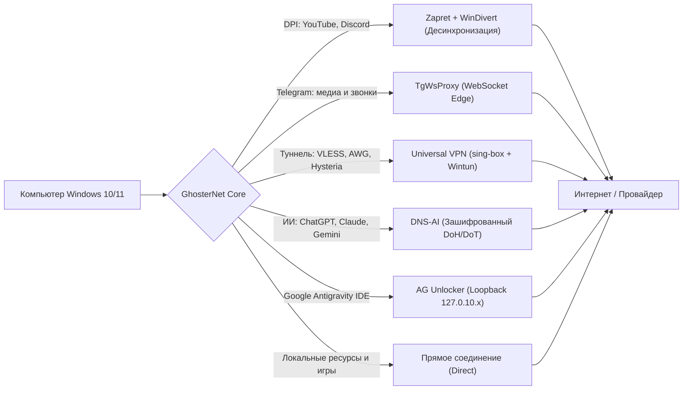
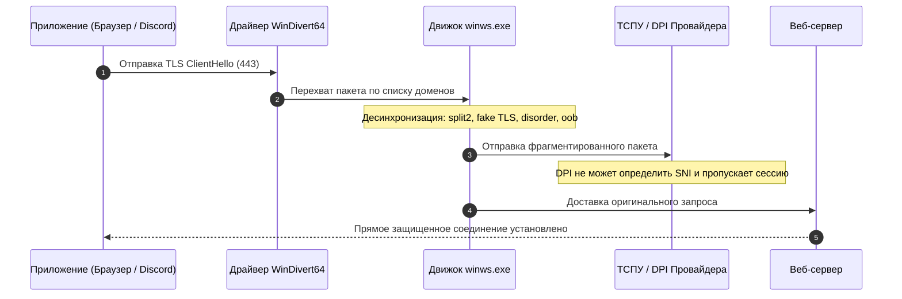
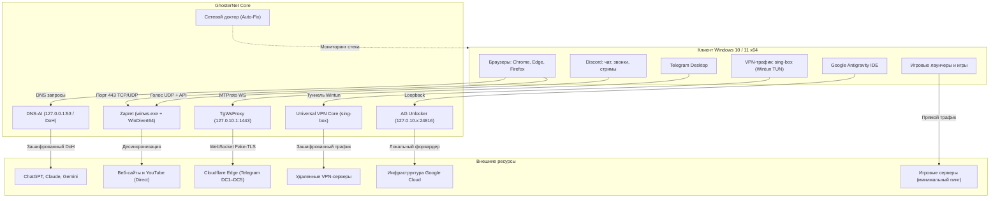

# GhosterNet

<div align="center">

  

  # GhosterNet v3.3.1
  
  **Единый сетевой инструмент для Windows 10 & 11 (x64)**  
  *Обход DPI (Zapret + WinDivert), Telegram MTProto WS, Universal VPN (sing-box + Wintun TUN), AmneziaWG (AWG), зашифрованный DNS-AI и разблокировка Google Antigravity IDE.*

  <p align="center">
    <a href="https://github.com/GhosterAI/GhosterNetApp/releases/latest"></a>
    <a href="https://github.com/GhosterAI/GhosterNetApp/releases"></a>
    <a href="./LICENSE"></a>
    
  </p>

  <p align="center">
    <a href="https://github.com/GhosterAI/GhosterNetApp/releases/latest/download/GhosterNet_x64.exe"><strong>Скачать установщик (.exe)</strong></a> •
    <a href="https://github.com/GhosterAI/GhosterNetApp/releases/latest/download/GhosterNet_x64-portable.7z"><strong>Скачать Portable (.7z)</strong></a> •
    <a href="#что-нового-в-331"><strong>Что нового</strong></a> •
    <a href="#быстрый-старт"><strong>Быстрый старт</strong></a> •
    <a href="#архитектура-и-модули"><strong>Архитектура</strong></a> •
    <a href="#часто-задаваемые-вопросы-faq"><strong>FAQ</strong></a>
  </p>

</div>

---

> [!NOTE]
> **GhosterNet** сочетает в себе технологии пакетной десинхронизации ядра сетевого стека Windows (WinDivert), локальные защищенные микро-мосты (Telegram WS, DNS-AI, Antigravity) и полноценный универсальный VPN-клиент на базе ядра sing-box и драйвера Wintun с интеллектуальной маршрутизацией.

---

## Содержание

- [О проекте](#о-проекте)
- [Что нового в 3.3.1](#что-нового-в-331)
- [Что нового в 3.3.0](#что-нового-в-330)
- [Сравнение подходов](#сравнение-подходов)
- [Архитектура и модули](#архитектура-и-модули)
  - [1. Zapret DPI Bypass](#1-zapret-dpi-bypass)
  - [2. Telegram WS Proxy и мониторинг DC](#2-telegram-ws-proxy-и-мониторинг-dc)
  - [3. Universal VPN и AmneziaWG (sing-box + Wintun)](#3-universal-vpn-и-amneziawg-sing-box--wintun)
  - [4. DNS-AI и DoH Resolver](#4-dns-ai-и-doh-resolver)
  - [5. Antigravity Unlocker](#5-antigravity-unlocker)
  - [6. Сетевой доктор и диагностика](#6-сетевой-доктор-и-диагностика)
  - [7. Системный трей и профили](#7-системный-трей-и-профили)
- [Схема маршрутизации трафика](#схема-маршрутизации-трафика)
  - [Каталог пресетов и списков обхода](#каталог-пресетов-и-списков-обхода)
- [Быстрый старт](#быстрый-старт)
- [Сборка из исходного кода](#сборка-из-исходного-кода)
- [Часто задаваемые вопросы (FAQ)](#часто-задаваемые-вопросы-faq)
- [Благодарности и открытые компоненты](#благодарности-и-открытые-компоненты)
- [Лицензия](#лицензия)

---

## О проекте

Современные сетевые ограничения строятся на комплексе разнородных блокировок: ТСПУ/DPI провайдеров, блокировка MTProto в Telegram, фильтрация голосовых UDP-сессий Discord и региональные ограничения зарубежных ИИ-платформ (Google Gemini, OpenAI ChatGPT, Claude) и инструментов разработки (Google Antigravity IDE).

Использование стандартного стороннего VPN для всех задач часто неэффективно:
- Снижение скорости соединения в несколько раз;
- Рост сетевой задержки (пинга) в онлайн-играх;
- Недоступность локальных сервисов (банки, Госуслуги, маркетплейсы);
- Периодическая блокировка стандартных протоколов туннелирования.

GhosterNet распределяет задачи по специализированным модулям:



---

## Что нового в 3.3.1

Релиз 3.3.1 — исправление сборки и одна правка вёрстки главного экрана.

**Исправлено**

- **Приложение не запускалось после установки 3.3.0.** В опубликованном установщике 3.3.0 файл `resources/app.asar` был собран с нарушенными смещениями данных: Electron не мог прочитать `package.json` и завершался сразу после старта — без окна и без сообщений. Архив пересобран и проверен (содержимое `app.asar` побайтово сверено с исходными файлами сборки), файлы релиза заменены.
- Лог сборки больше не пишется в каталог проекта, чтобы не попадать в пакет и не менять файлы во время упаковки.

**Изменено**

- Три главных переключателя (**Zapret**, **Telegram**, **VPN**) на главной странице выровнены по центру окна: раньше блок стоял заметно выше середины, теперь его центр совпадает с центром окна с точностью до пары пикселей.

---

## Что нового в 3.3.0

Релиз 3.3.0 — «чистка» интерфейса: из приложения убраны четыре вспомогательные функции, которые дублировали уже существующие инструменты или работали нестабильно. На работу обхода DPI, Telegram WS, VPN и DNS-AI это не влияет.

**Удалено**

| Функция | Что делать вместо неё |
| :--- | :--- |
| Генератор Cloudflare WARP «в 1 клик» | Добавить профиль вручную: кнопки «Из буфера», «.conf файл» или `+` на странице **VPN**. Любой WireGuard/AmneziaWG-конфиг, включая WARP, импортируется как обычно. |
| Виджет «AI Dashboard» (статус нейросетей + «1-Click AI Fix») | Проверка ИИ-сервисов и автонастройка Gemini в hosts остались на странице **Сеть и DNS** (блок DNS-AI). |
| Виджет «Live HUD» (график скорости на главной) | Индикатор состояния сервисов остался на главной (Zapret / Telegram / VPN). Для контроля расхода трафика — «Диспетчер задач» Windows или любой монитор сети. |
| Встроенный Speedtest (спидометр) | Любой внешний замер скорости — тест больше не нагружает канал приложением. |

**Прочее**

- Удалён мёртвый код и неиспользуемые IPC-каналы (`warp:generate`, `speedtest:run`, поток `traffic:tick`), контракт main ↔ renderer сократился до 126 обработчиков.
- JS-бандл рендерера уменьшился примерно на 18 КБ, CSS — на 2.9 КБ, стартовый main-процесс — на 9 КБ.
- Обновлены документация и ссылки в README.

---

## Сравнение подходов

| Характеристика | Обычный VPN | GoodbyeDPI | Zapret (консольный) | GhosterNet v3.3.1 |
| :--- | :---: | :---: | :---: | :---: |
| **Скорость загрузки** | Ограничена сервером | 100% канала | 100% канала | **100% канала** |
| **Задержка в играх** | +50...150 мс | Без изменений | Без изменений | **0 мс задержки (игровой фильтр)** |
| **YouTube 4K 60FPS** | Зависит от сервера | Возможна буферизация | Ручная настройка BAT | **Штатная поддержка (QUIC + ALT-профили)** |
| **Discord (Голос + Видео)** | Работает | Не обрабатывает UDP | Требует сложных BAT | **Встроенный фильтр TCP + UDP** |
| **Telegram (Медиа и звонки)** | Блокируется | Не поддерживается | Не поддерживается | **TgWsProxy + мониторинг DC1–DC5** |
| **Universal VPN & AWG** | Отдельное приложение | Не поддерживается | Не поддерживается | **Встроенный sing-box v1.14 + Wintun** |
| **Google Antigravity IDE** | Требует смены региона | Не поддерживается | Не поддерживается | **Разблокировка без смены региона** |
| **ИИ-сервисы (Gemini, ChatGPT)**| Блокировка аккаунтов | Не поддерживается | Не поддерживается | **Шифрованный DoH (DNS-AI)** |
| **Графический интерфейс** | Да | Консоль | BAT-скрипты | **Современный минималистичный UI** |
| **Автоматическая диагностика**| Нет | Нет | Нет | **Доктор сети (исправление в 1 клик)** |

---

## Архитектура и модули

### 1. Zapret DPI Bypass

Модуль обхода глубокого анализа пакетов. Работает на базе драйвера ядра **WinDivert64.sys**, перехватывая исходящие рукопожатия TLS (ClientHello), HTTP-запросы и определенные UDP-пакеты.



- **Более 20 готовых стратегий**: пресеты `general (ALT 1–12.2)`, оптимизированные профили `GhosterNet Hub`, специализированные профили для игровых лаунчеров (EA, Minecraft, Roblox).
- **Матричный бенчмарк**: проверка комбинаций `IPset` и `Game Filter` с замером времени отклика.
- **Игровой фильтр портов**: исключение игрового трафика из обработки драйвером для предотвращения задержек.
- **Совместимость с VPN (Coexistence)**: автоматическое определение адаптеров WireGuard, OpenVPN, WARP и исключение их адресов из фильтрации.

---

### 2. Telegram WS Proxy и мониторинг DC

В условиях блокировок стандартного протокола MTProto модуль поднимает локальный мост на `127.0.0.1:1443` и передает трафик мессенджера через WebSocket-соединение с защитой Fake-TLS.

- **Спидтест датацентров (DC Ping)**: отображение времени отклика в реальном времени до каждого датацентра Telegram (`DC1`–`DC5`) для выбора оптимального маршрута медиа.
- **Алгоритмы Fast Tune и Full Tune**: автоматический перебор и выбор наилучшей конфигурации соединения.
- **Быстрое подключение**: переход по ссылке `tg://proxy?server=127.0.0.1&port=1443&secret=...` для моментальной активации в Telegram Desktop.

---

### 3. Universal VPN и AmneziaWG (sing-box + Wintun)

Полнофункциональный VPN-клиент, встроенный непосредственно в интерфейс GhosterNet.

- **Ядро sing-box v1.14 + драйвер Wintun**: поддержка современных протоколов туннелирования:
  - **VLESS** (с технологией Reality);
  - **AmneziaWG (AWG)** — модифицированный WireGuard с защитой от блокировок;
  - **Hysteria 2** (протокол на базе UDP/QUIC);
  - **Trojan** и **Shadowsocks**.
- **Три режима маршрутизации**:
  - **Умный обход (РФ напрямую)**: российские домены и сервисы открываются через локального провайдера без потери скорости, а заблокированные ресурсы направляются через VPN. Режим работает на базе встроенных локальных бинарных правил `geosite-ru.srs` и `geoip-ru.srs` без необходимости их фоновой загрузки из сети;
  - **Полный туннель (Global)**: весь сетевой трафик системы направляется в защищенный туннель;
  - **Только локальный прокси**: туннелирование без создания виртуального сетевого адаптера с предоставлением локальных портов (HTTP: 2080, SOCKS5: 2081).
- **Минималистичный интерфейс**:
  - Импорт подписок и конфигураций по ссылке, из буфера обмена в 1 клик или через файл `.conf` (WireGuard / AmneziaWG);
  - Векторные SVG-флаги стран (`country-flag-icons`) с автоопределением по кодам ISO, русским и английским названиям;
  - Компактный замер пинга всех серверов одной кнопкой;
  - Быстрое переключение серверов на лету.

---

### 4. DNS-AI и DoH Resolver

Решение для обхода региональных ограничений веб-интерфейсов и API ИИ-платформ (Google Gemini, OpenAI ChatGPT, Anthropic Claude, GitHub Copilot) без замедления остального трафика.

- **Два режима работы**:
  - **Локальный Stub-прокси (`127.0.0.1:53`)**: служба перехватывает DNS-запросы на петлевом интерфейсе и передает их через шифрованные протоколы DoH/DoT;
  - **Нативный DoH Windows 11**: регистрация резолвера непосредственно в сетевом стеке операционной системы через системный API.
- **Специализированные серверы**: Comss.one, Xbox Smart DNS, Malw.link, Cloudflare, Quad9 с отображением пинга каждого узла.
- **Аварийный сброс**: возврат всех сетевых интерфейсов к стандартным настройкам DHCP в случае сбоев.

---

### 5. Antigravity Unlocker

Специализированный модуль для разработчиков, снимающий региональные ограничения среды **Google Antigravity IDE** в России без необходимости включения общего VPN и смены региона учетной записи Google.

- **Loopback IP Binding**: назначение виртуальных адресов `127.0.10.2–6` на петлевой адаптер.
- **Watchdog-демон**: поддержание работы локального прокси-сервера (порт `24816`) и форвардера запросов.
- **Патчинг IDE**: автоматическая модификация компонентов редактора с возможностью мгновенного отката к исходному состоянию.
- **Быстрый запуск**: применение настроек и запуск среды разработки одним действием.

---

### 6. Сетевой доктор и диагностика

Встроенный диагностический комплекс для анализа сетевого окружения и устранения неисправностей:

- **Автоматическое исправление в 1 клик**:
  - Сброс системного кэша DNS (`ipconfig /flushdns`);
  - Очистка кэша Discord (GPU Cache и Code Cache);
  - Перезапуск службы базовой фильтрации Windows (BFE);
  - Снятие зависших блокировок драйвера WinDivert и очистка сетевых сокетов;
  - Перезапуск локальных служб GhosterNet.
- **Мониторинг доступности**: оперативная проверка доступности YouTube, Discord, Telegram и ИИ-платформ.

---

### 7. Системный трей и профили

- **Компактный режим**: сворачивание в системный трей Windows с управлением всеми модулями из контекстного меню.
- **Экспорт и импорт профилей (`.ghosternet`)**: перенос пользовательских настроек, списков доменов, выбранных стратегий и конфигураций на другие устройства.

---

## Схема маршрутизации трафика



---

### Каталог пресетов и списков обхода

- **24 готовых пресета сервисов**:
  - Игры и лаунчеры: Steam, Epic Games, Battle.net, Riot Games, EA App, Ubisoft Connect, Roblox, Minecraft;
  - Медиа и социальные сети: YouTube, Discord, Twitch, Spotify, Twitter/X, Instagram, Facebook, TikTok;
  - Разработка и ИИ: OpenAI / ChatGPT, Anthropic / Claude, Google Gemini, Google Antigravity, GitHub, Notion, Canva, Figma.
- **Пользовательские списки**:
  - `list-general-user.txt` — персональные домены для десинхронизации;
  - `list-exclude-user.txt` — исключения из перехвата;
  - `ipset-all-user.txt` и `ipset-exclude-user.txt` — диапазоны IP-адресов.
- **Редактор hosts**: встроенный инструмент редактирования системного файла `hosts` с автоматическим резервным копированием.

---

## Быстрый старт

### 1. Скачивание

Перейдите в раздел [Релизов GhosterNet](https://github.com/GhosterAI/GhosterNetApp/releases/latest) и загрузите дистрибутив:
- **`GhosterNet_x64.exe`** — установщик Windows (создает ярлыки, настраивает интеграцию и ассоциации протоколов `ghosternet://` и `tg-ws://`);
- **`GhosterNet_x64-portable.7z`** — портативная версия без необходимости инсталляции.

### 2. Первый запуск

> [!IMPORTANT]
> Для управления сетевым драйвером `WinDivert64.sys`, службой DNS и маршрутизацией приложению требуются права администратора.

1. **Запуск Zapret**: на вкладке «Zapret» запустите автоматический тест стратегий. Приложение определит оптимальный профиль для вашего провайдера.
2. **Запуск Telegram WS**: на вкладке «Telegram» запустите быстрый подбор и нажмите «Подключить в Telegram».
3. **Запуск Universal VPN**: на вкладке «VPN» добавьте ссылку подписки или файл `.conf`, выберите сервер и нажмите кнопку подключения.
4. **Запуск DNS-AI**: на вкладке «DNS-AI» активируйте резолвер для доступа к ИИ-сервисам без VPN.
5. **Запуск Google Antigravity**: на вкладке «Antigravity» нажмите «Быстрый запуск» для работы в среде разработки.

---

## Сборка из исходного кода

### Требования
- Windows 10 или 11 (64-бит);
- Node.js версии 20 или новее;
- pnpm версии 9 или новее (`npm install -g pnpm`);
- Git.

### Инструкция

```bash
# 1. Клонирование репозитория
git clone https://github.com/GhosterAI/GhosterNetApp.git
cd GhosterNetApp

# 2. Установка зависимостей
pnpm install

# 3. Запуск в режиме разработки
pnpm dev

# 4. Проверка типов и линтинг
pnpm typecheck
pnpm lint

# 5. Сборка исполняемых файлов (Installer .exe + Portable .7z)
pnpm run build:win
```

Готовые файлы будут созданы в каталоге `dist/`:
- `dist/GhosterNet_x64.exe`
- `dist/GhosterNet_x64-portable.7z`

---

## Часто задаваемые вопросы (FAQ)

<details>
<summary><strong>1. Безопасно ли приложение? Антивирус предупреждает о WinDivert64.sys.</strong></summary>
<br>
Исходный код GhosterNet полностью открыт под лицензией GPL-3.0. Драйвер <code>WinDivert64.sys</code> — стандартный инструмент перехвата сетевых пакетов с официальной цифровой подписью. Некоторые защитные системы могут выдавать ложные срабатывания (False Positive) на драйверы прямого доступа к сетевому стеку.
</details>

<details>
<summary><strong>2. Что делать при сбое сетевого подключения?</strong></summary>
<br>
В разделе «Диагностика» воспользуйтесь функцией «Починить сеть в 1 клик». Приложение сбросит кэш DNS, освободит сокеты драйвера WinDivert, перезапустит службу BFE и восстановит исходные параметры сетевых адаптеров.
</details>

<details>
<summary><strong>3. Можно ли использовать GhosterNet одновременно с другим VPN?</strong></summary>
<br>
Да. Встроенный механизм VPN Coexistence автоматически определяет виртуальные сетевые интерфейсы (WireGuard, OpenVPN, TUN/TAP, WARP) и исключает их трафик из перехвата драйвером WinDivert.
</details>

<details>
<summary><strong>4. В чем разница между Stub 127.0.0.1:53 и нативным DoH Windows 11 в DNS-AI?</strong></summary>
<br>
Режим Stub запускает локальную службу на порту 53 и совместим с Windows 10 и 11. Режим нативного DoH использует встроенный стек DNS-over-HTTPS операционной системы Windows 11 без занятия локального порта.
</details>

<details>
<summary><strong>5. Как перенести настройки на другой компьютер?</strong></summary>
<br>
В разделе «Сервисы и списки» нажмите «Экспорт профиля» для сохранения конфигурации в файл <code>.ghosternet</code>. На целевом компьютере выберите «Импорт профиля».
</details>

---

## Благодарности и открытые компоненты

В проекте используются разработки и компоненты открытого сообщества:

- **[bol-van/zapret](https://github.com/bol-van/zapret)** — концепция и реализация обхода DPI на пакетном уровне;
- **[Flowseal/zapret-discord-youtube](https://github.com/Flowseal/zapret-discord-youtube)** — бинарные сборки winws и наборы стратегий;
- **[Flowseal/tg-ws-proxy](https://github.com/Flowseal/tg-ws-proxy)** — реализация локального WebSocket-моста для Telegram;
- **[SagerNet/sing-box](https://github.com/SagerNet/sing-box)** — высокопроизводительное универсальное сетевое ядро;
- **[confeden/DNS-AI](https://github.com/confeden/DNS-AI)** — шифрованный DNS-резолвер для обхода региональных ограничений;
- **[confeden/Antigravity](https://github.com/confeden/Antigravity)** — модуль разблокировки среды Google Antigravity IDE;
- **[basil00/WinDivert](https://reqrypt.org/windivert.html)** — драйвер захвата и модификации сетевых пакетов Windows.

---

## Лицензия

Проект **GhosterNet** распространяется под свободной лицензией **GNU General Public License v3.0 (GPL-3.0)**.  
Полный текст лицензии доступен в файле [LICENSE](./LICENSE).

Входящие в состав сторонние бинарные компоненты и библиотеки распространяются под соответствующими лицензиями правообладателей.

---

<div align="center">
  <sub>GhosterAI © 2026</sub>
</div>
