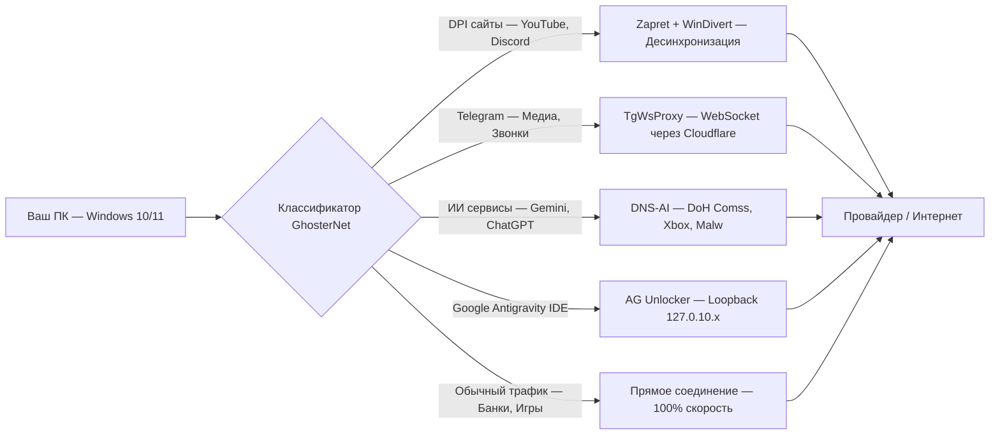
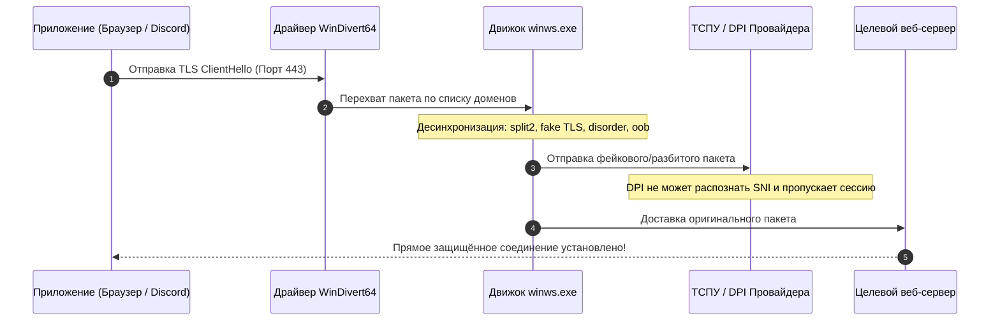
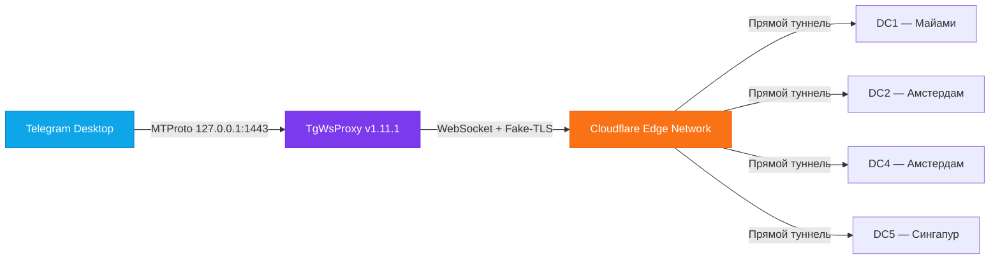
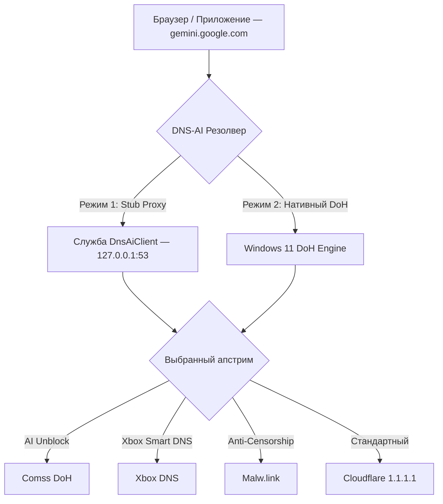
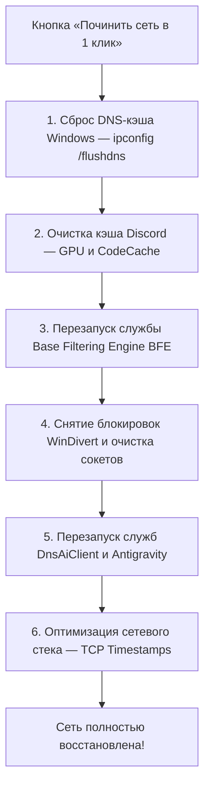
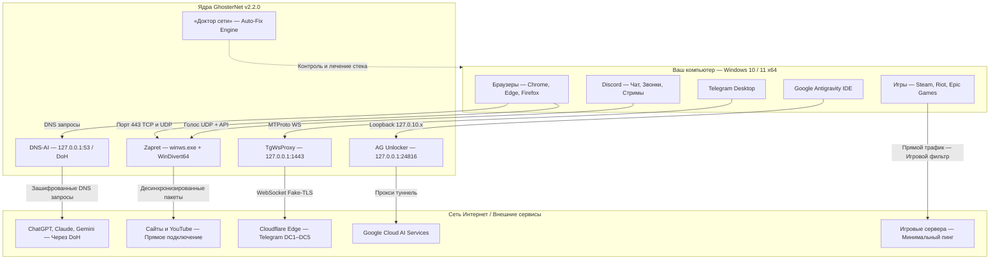

# GhosterNet

<div align="center">

  

  # GhosterNet v2.2.0
  
  **Единый швейцарский нож сетевой свободы для Windows 10 & 11 (x64)**  
  *Обход DPI, ускорение Telegram MTProto, зашифрованный DNS-AI, разблокировка Google Antigravity IDE и «Доктор сети» в один клик.*

  <p align="center">
    <a href="https://github.com/GhosterAI/GhosterNetApp/releases/latest"></a>
    <a href="https://github.com/GhosterAI/GhosterNetApp/releases"></a>
    <a href="./LICENSE"></a>
    
  </p>

  <p align="center">
    <a href="https://github.com/GhosterAI/GhosterNetApp/releases/latest/download/GhosterNet_x64.exe"><strong>📥 Скачать установщик (.exe)</strong></a> •
    <a href="https://github.com/GhosterAI/GhosterNetApp/releases/latest/download/GhosterNet_x64-portable.7z"><strong>📦 Скачать Portable (.7z)</strong></a> •
    <a href="https://github.com/GhosterAI/GhosterNet"><strong>🌐 Официальный сайт</strong></a> •
    <a href="#-быстрый-старт"><strong>🚀 Быстрый старт</strong></a> •
    <a href="#-архитектура-и-модули"><strong>🏗️ Архитектура</strong></a> •
    <a href="#-faq"><strong>❓ FAQ</strong></a>
  </p>

</div>

---

> [!NOTE]
> **GhosterNet** не является VPN-сервисом в привычном понимании. Он **не туннелирует весь трафик через удалённый сервер** и **не снижает скорость канала**. Приложение точечно модифицирует пакеты на уровне ядра сетевого стека Windows (WinDivert), поднимает локальные микро-мосты и шифрует DNS, сохраняя оригинальный IP, нулевую потерю скорости и минимальный пинг в онлайн-играх.

---

## 📑 Содержание

- [💡 Зачем нужен GhosterNet?](#-зачем-нужен-ghosternet)
- [⚖️ Сравнение: GhosterNet vs VPN vs GoodbyeDPI](#-сравнение-ghosternet-vs-vpn-vs-goodbyedpi)
- [🏗️ Архитектура и модули](#-архитектура-и-модули)
  - [1. Zapret DPI Bypass (v1.10.3)](#1-zapret-dpi-bypass-v1103)
  - [2. Telegram WS Proxy & DC Ping (v1.11.1)](#2-telegram-ws-proxy--dc-ping-v1111)
  - [3. DNS-AI & DoH Resolver (v1.0.0)](#3-dns-ai--doh-resolver-v100)
  - [4. Antigravity Unlocker (v2.21.1)](#4-antigravity-unlocker-v2211)
  - [5. 🩺 «Доктор сети» (Auto-Fix в 1 клик)](#5--доктор-сети-auto-fix-в-1-клик)
  - [6. 🎛️ «Умный Трей» (Smart Tray)](#6-️-умный-трей-smart-tray)
  - [7. 💾 Экспорт и импорт профилей (.ghosternet)](#7--экспорт-и-импорт-профилей-ghosternet)
- [📊 Глобальная схема маршрутизации](#-глобальная-схема-маршрутизации)
- [🎯 Каталог пресетов и управление списками](#-каталог-пресетов-и-управление-списками)
- [🔄 Автоматическое обновление всех ядер](#-автоматическое-обновление-всех-ядер)
- [🚀 Быстрый старт](#-быстрый-старт)
- [🛠️ Сборка из исходного кода](#-сборка-из-исходного-кода)
- [❓ Часто задаваемые вопросы (FAQ)](#-часто-задаваемые-вопросы-faq)
- [❤️ Благодарности и сторонние проекты](#-благодарности-и-сторонние-проекты)
- [📄 Лицензия](#-лицензия)

---

## 💡 Зачем нужен GhosterNet?

В современных реалиях сетевые ограничения в России и СНГ строятся на сложных многоуровневых механизмах ТСПУ/DPI, блокировках протокола MTProto в Telegram, фильтрации голосовых пакетов Discord (UDP/Voice) и геоблокировках популярных ИИ-сервисов (Google Gemini, ChatGPT, Claude, Copilot) и инструментов разработки (Google Antigravity IDE).

Обычные VPN-сервисы создают массу неудобств:
- ❌ **Урезают скорость канала** в 3–10 раз;
- ❌ **Увеличивают пинг** в онлайн-играх на 50–150 мс;
- ❌ **Ломают российские сайты** (Госуслуги, банки, маркетплейсы);
- ❌ Постоянно блокируются протоколы (WireGuard, OpenVPN, Shadowsocks).

**GhosterNet решает эту проблему комплексно и элегантно:**



---

## ⚖️ Сравнение: GhosterNet vs VPN vs GoodbyeDPI

| Параметр / Функция | Обычный VPN | GoodbyeDPI | Zapret (чистый консольный) | **GhosterNet v2.2.0** |
| :--- | :---: | :---: | :---: | :---: |
| **Скорость скачивания** | Режется сервером | 100% канала | 100% канала | **100% канала** |
| **Пинг в онлайн-играх** | +50...150 мс | Без изменений | Без изменений | **0 мс задержки (Игровой фильтр)** |
| **YouTube 4K 60FPS & QUIC** | Зависит от сервера | Часто буферизует | Настраивается вручную | **Мгновенно (Блокировка QUIC + ALT-стратегии)** |
| **Discord (Голос + Стримы)** | Работает | Не чинит Voice UDP | Требует сложных BAT | **Работает из коробки (TCP + UDP фильтр)** |
| **Telegram (Медиа и Звонки)** | Блокируется РКН | Не умеет | Не умеет | **TgWsProxy v1.11.1 + Спидтест DC1–DC5** |
| **Google Antigravity IDE** | Требует смены региона | Не умеет | Не умеет | **Разблокировка без VPN (AG v2.21.1)** |
| **ChatGPT, Gemini, Claude** | Блокирует аккаунты | Не умеет | Не умеет | **DNS-AI DoH (Comss / Xbox / Malw.link)** |
| **Автоподбор стратегий** | Нет | Нет | Консольный blockcheck | **Встроенный автотест в 1 клик с рейтингом** |
| **Автопочинка сети («Доктор сети»)** | Нет | Нет | Нет | **Auto-Fix в 1 клик (BFE, DNS, WinDivert, Discord)** |
| **Графический интерфейс** | Да | Нет (CMD) | Нет (BAT файлы) | **Красивый современный UI (Тёмная/Светлая тема)** |
| **Smart Tray & HUD** | Простой | Нет | Нет | **Управление всеми ядрами в 1 клик + Live HUD** |

---

## 🏗️ Архитектура и модули

### 1. Zapret DPI Bypass (`v1.10.3`)

Сердце пакетного обхода блокировок. Работает в тандеме с низкоуровневым драйвером **WinDivert64.sys**, перехватывая только исходящие рукопожатия TLS (Client Hello), HTTP GET и специфические UDP-пакеты.



- **20+ встроенных стратегий**:
  - `general (ALT 1–12.2)` — от классических методов разбивки пакетов до современных обходов ТСПУ 2026 года;
  - `GhosterNet Hub` — эксклюзивные оптимизированные стратегии для провайдеров РФ;
  - `EA`, `Minecraft`, `Roblox` — выделенные игровые профили.
- **Матричный бенчмарк (`IPset × Game Filter`)**: автоматический тест режимов `Loaded`, `None`, `Any` и портов `1024–65535` для поиска идеального баланса скорости и стабильности.
- **Игровой фильтр портов**: порты онлайн-игр исключаются из обработки WinDivert, устраняя микрофризы и потери пакетов.
- **VPN Coexistence**: интеллектуальное обнаружение виртуальных адаптеров WireGuard, OpenVPN, Cloudflare WARP, TUN/TAP — их адреса и порты исключаются из перехвата, предотвращая любые конфликты.

---

### 2. Telegram WS Proxy & DC Ping (`v1.11.1`)

Официальный клиент Telegram в условиях блокировок MTProto испытывает проблемы с долгой загрузкой видео, голосовых сообщений и разрывами звонков. Встроенный **TgWsProxy** поднимает локальный сервер на `127.0.0.1:1443` и туннелирует трафик мессенджера через защищённое WebSocket-соединение с инфраструктурой Cloudflare.



- **🌐 Интерактивный спидтест датацентров (DC Ping)**:
  Вкладка Telegram отображает живой пинг в миллисекундах до каждого датацентра Telegram (`DC1`–`DC5`) и автоматически подсвечивает датацентр с наименьшей задержкой для медиафайлов.
- **Алгоритмы автоподбора (`Fast Tune` / `Full Tune`)**:
  Тестируют задержку WebSocket-рукопожатий и определяют наилучший мост с автоматическим применением настроек.
- **Автоподключение в 1 клик**:
  Кнопка `tg://proxy?server=127.0.0.1&port=1443&secret=...` моментально активирует прокси в Telegram Desktop.

---

### 3. DNS-AI & DoH Resolver (`v1.0.0`)

Инструмент обхода геоблокировок ИИ-сервисов (ChatGPT, Claude, Google Gemini, GitHub Copilot) без необходимости использования медленного VPN.



- **Два режима работы**:
  1. **Локальный Stub-прокси (`127.0.0.1:53`)**: системная служба перехватывает DNS-запросы на петлевом интерфейсе, шифрует их по протоколам DoH/DoT и резолвит заблокированные адреса.
  2. **Нативный DoH Windows 11**: автоматическая регистрация защищённого HTTPS-резолвера прямо в сетевом стеке Windows через PowerShell API (`Set-DnsClientDoHServerAddress`).
- **Специализированные апстримы**: Comss.one, Xbox Smart DNS, Malw.link, Cloudflare, Quad9.
- **Живой пинг эндпоинтов**: отображение времени отклика DoH-серверов в реальном времени.
- **Аварийный сброс (Rescue Network)**: мгновенный возврат всех сетевых адаптеров к стандартному автоматическому DHCP при любых сбоях.

---

### 4. Antigravity Unlocker (`v2.21.1`)

Специализированный модуль для разработчиков, позволяющий работать в новейшей **Google Antigravity IDE** прямо из России без использования VPN и без смены региона аккаунта Google.

- **Loopback IP Binding**: назначение виртуальных адресов `127.0.10.2–6` на loopback-адаптер.
- **Фоновый демон и Watchdog**: непрерывный мониторинг состояния локального прокси на порту `24816` и DNS-форвардера.
- **Автоматический патчинг IDE**: безопасная модификация `product.json`, `workbench`, `language_server` и файлов `asar` с возможностью отката в один клик.
- **Режим «Быстрый запуск» (Auto-Run)**: поднять службы, пропатчить IDE и запустить редактор нажатием одной кнопки.

---

### 5. 🩺 «Доктор сети» (Auto-Fix в 1 клик)

Комплексный инструмент восстановления работоспособности операционной системы при любых сетевых неполадках, зависаниях сокетов или конфликтах со сторонними программами.



#### Live Security HUD & Мониторинг доступности
Интерактивный виджет в шапке приложения в реальном времени измеряет пинг и статус ключевых сервисов:
- 🔴/🟢 **YouTube 4K** (QUIC UDP 443 & HTTPS TLS)
- 🔴/🟢 **Discord** (Voice Gateway UDP & API HTTPS)
- 🔴/🟢 **Telegram** (Датацентры DC1–DC5)
- 🔴/🟢 **ИИ сервисы** (Google Gemini, OpenAI ChatGPT, Anthropic Claude)

---

### 6. 🎛️ «Умный Трей» (Smart Tray)

GhosterNet сворачивается в компактную иконку системного трея Windows, предоставляя быстрый доступ ко всем основным функциям:
- Включение / выключение **Zapret DPI** в 1 клик;
- Запуск / остановка **Telegram WS Proxy**;
- Быстрое переключение **DNS-AI (DoH)**;
- Управление **Antigravity Unlocker**;
- Запуск **«Доктора сети»** прямо из трея;
- Моментальная проверка обновлений всех компонентов;
- Информативный тултип при наведении: показывает активные стратегии и статус модулей.

---

### 7. 💾 Экспорт и импорт профилей (`.ghosternet`)

Больше не нужно заново настраивать приложение после переустановки Windows или при покупке нового ноутбука:
- **Экспорт профиля**: сохранение всех пользовательских списков, выбранных стратегий, исключений, мостов Telegram и настроек DNS в единый файл `.ghosternet` (или `.json`).
- **Импорт профиля**: моментальное восстановление вашей идеальной конфигурации на любом компьютере в один клик.

---

## 📊 Глобальная схема маршрутизации



---

## 🎯 Каталог пресетов и управление списками

В GhosterNet интегрирован удобный менеджер доменов и списков:

- **24 готовых пресета сервисов в 3 категориях**:
  - 🎮 **Игры и лаунчеры**: Steam, Epic Games, Battle.net, Riot Games, EA App, Ubisoft Connect, Roblox, Minecraft.
  - 📱 **Соцсети и медиа**: YouTube, Discord, Twitch, Spotify, Twitter/X, Instagram, Facebook, TikTok.
  - 🤖 **Работа и ИИ**: OpenAI / ChatGPT, Anthropic / Claude, Google Gemini, Google Antigravity, GitHub, Notion, Canva, Figma.
- **4 пользовательских списка**:
  - `list-general-user.txt` — ваши личные домены для обхода DPI;
  - `list-exclude-user.txt` — домены-исключения, которые должны идти строго напрямую;
  - `ipset-all-user.txt` — пользовательские IP-подсети;
  - `ipset-exclude-user.txt` — исключения IP-адресов.
- **Редактор файла `hosts`**: безопасное добавление и удаление записей в системном файле `hosts` с автоматическим сохранением бэкапа.

---

## 🔄 Автоматическое обновление всех ядер

GhosterNet следит за актуальностью всех сетевых инструментов без участия пользователя:

| Компонент | Репозиторий апстрима | Назначение |
| :--- | :--- | :--- |
| **GhosterNet App** | [GhosterAI/GhosterNetApp](https://github.com/GhosterAI/GhosterNetApp) | Главная оболочка клиента и службы |
| **Zapret** | [Flowseal/zapret-discord-youtube](https://github.com/Flowseal/zapret-discord-youtube) | Бинарники `winws.exe`, стратегии и списки |
| **TgWsProxy** | [Flowseal/tg-ws-proxy](https://github.com/Flowseal/tg-ws-proxy) | Ядро WebSocket-прокси для Telegram |
| **DNS-AI** | [confeden/DNS-AI](https://github.com/confeden/DNS-AI) | Локальный DoH/DoT резолвер для ИИ |
| **Antigravity Unlocker** | [confeden/Antigravity](https://github.com/confeden/Antigravity) | Демон и патчер для Google Antigravity IDE |

---

## 🚀 Быстрый старт

### 1. Скачивание и установка

1. Перейдите на страницу [Релизов GhosterNet](https://github.com/GhosterAI/GhosterNetApp/releases/latest).
2. Выберите подходящий вариант:
   - **`GhosterNet_x64.exe`** — полноценный установщик (рекомендуется): создаст ярлыки в меню «Пуск», настроит автозапуск и зарегистрирует протоколы `ghosternet://` и `tg-ws://`.
   - **`GhosterNet_x64-portable.7z`** — портативная версия: распакуйте в любую удобную папку (например, `C:\GhosterNet`) и запускайте без установки.

### 2. Первый запуск

> [!IMPORTANT]
> Приложению требуются права **Администратора** для управления пакетным драйвером `WinDivert64.sys`, службой DNS и системным файлом `hosts`. При первом запуске подтвердите запрос UAC.

1. **Запуск Zapret**: на вкладке «Zapret» нажмите кнопку **«Тестировать стратегии»**. Клиент проверит доступность YouTube и Discord через разные стратегии и автоматически включит лучшую для вашего провайдера.
2. **Запуск Telegram WS**: на вкладке «Telegram» нажмите **«Быстрый подбор (Fast Tune)»**, затем нажмите **«Подключить в Telegram»**.
3. **Запуск DNS-AI**: на вкладке «DNS-AI» выберите апстрим (например, `Comss (DoH)`) и переведите тумблер во включённое положение — ChatGPT и Google Gemini заработают мгновенно.
4. **Google Antigravity IDE**: на вкладке «Antigravity» нажмите кнопку **«Быстрый запуск»** — редактор запустится с автоматической разблокировкой.

---

## 🛠️ Сборка из исходного кода

### Предварительные требования
- **ОС**: Windows 10 или Windows 11 (64-бит)
- **Node.js**: версия 20.x или новее
- **pnpm**: версия 9.x (`npm install -g pnpm`)
- **Git**

### Инструкция по сборке

```bash
# 1. Клонирование репозитория
git clone https://github.com/GhosterAI/GhosterNetApp.git
cd GhosterNetApp

# 2. Установка зависимостей
pnpm install

# 3. Запуск приложения в режиме разработки
pnpm dev

# 4. Проверка типов TypeScript
pnpm typecheck

# 5. Сборка релизных дистрибутивов (Installer .exe + Portable .7z)
pnpm run build:win
```

Собранные файлы будут находиться в папке `dist/`:
- `dist/GhosterNet_x64.exe` (~172 МБ)
- `dist/GhosterNet_x64-portable.7z` (~148 МБ)

---

## ❓ Часто задаваемые вопросы (FAQ)

<details>
<summary><strong>1. Безопасно ли приложение? Антивирус ругается на WinDivert64.sys.</strong></summary>
<br>
Да, GhosterNet полностью безопасен, а его исходный код на 100% открыт под лицензией GPL-3.0. Драйвер <code>WinDivert64.sys</code> — это всемирно известный открытый драйвер захвата пакетов, имеющий официальную цифровую подпись. Некоторые антивирусы могут ложно срабатывать на драйверы перехвата сетевых пакетов (False Positive). Добавьте папку с программой в исключения антивируса.
</details>

<details>
<summary><strong>2. Что делать, если пропал интернет после некорректного закрытия ПК?</strong></summary>
<br>
Откройте GhosterNet, перейдите во вкладку <strong>«Диагностика»</strong> и нажмите кнопку <strong>«Починить сеть в 1 клик» (Auto-Fix)</strong>. Приложение мгновенно сбросит кэш DNS, снимет зависшие блокировки драйверов, восстановит стандартные настройки адаптеров Windows и перезапустит службу фильтрации BFE.
</details>

<details>
<summary><strong>3. Можно ли использовать GhosterNet одновременно с обычным VPN?</strong></summary>
<br>
<strong>Да!</strong> В GhosterNet встроена система <em>VPN Coexistence</em>. Приложение автоматически обнаруживает активные виртуальные сетевые адаптеры (WireGuard, OpenVPN, TUN/TAP, WARP) и исключает их IP-адреса и UDP-порты из перехвата WinDivert, предотвращая любые зацикливания или конфликты маршрутизации.
</details>

<details>
<summary><strong>4. Почему YouTube работает, а голосовые каналы Discord не подключаются?</strong></summary>
<br>
Для работы голосовых каналов Discord требуется прохождение UDP-пакетов. Убедитесь, что в настройках стратегии Zapret параметр <strong>«Игровой фильтр»</strong> установлен в режим <code>TCP + UDP</code>, а также нажмите кнопку «Очистить кэш Discord» во вкладке «Диагностика».
</details>

<details>
<summary><strong>5. В чём разница между Stub 127.0.0.1:53 и нативным DoH Windows 11 в DNS-AI?</strong></summary>
<br>
- <strong>Stub (127.0.0.1:53)</strong>: системная служба DnsAiClient слушает порт 53 локально и подходит для любых версий Windows 10 и 11.<br>
- <strong>Нативный DoH Windows 11</strong>: использует встроенный в Windows 11 движок DNS-over-HTTPS на уровне операционной системы, не занимая локальный порт 53. Оба режима обеспечивают полную разблокировку ChatGPT и Google Gemini.
</details>

<details>
<summary><strong>6. Как перенести настройки на другой компьютер?</strong></summary>
<br>
Во вкладке «Сервисы и Списки» нажмите кнопку <strong>«Экспорт профиля»</strong> и сохраните файл <code>.ghosternet</code>. На новом компьютере откройте GhosterNet, нажмите <strong>«Импорт профиля»</strong> и выберите этот файл. Все ваши стратегии, списки и мосты перенесутся мгновенно.
</details>

---

## ❤️ Благодарности и сторонние проекты

GhosterNet объединяет и развивает наработки потрясающих проектов с открытым исходным кодом:

- **[bol-van/zapret](https://github.com/bol-van/zapret)** — фундаментальный проект для обхода DPI на пакетном уровне;
- **[Flowseal/zapret-discord-youtube](https://github.com/Flowseal/zapret-discord-youtube)** — готовые сборки, стратегии и сервис-скрипты Zapret для Windows;
- **[Flowseal/tg-ws-proxy](https://github.com/Flowseal/tg-ws-proxy)** — высокопроизводительный локальный прокси MTProto over WebSocket;
- **[confeden/DNS-AI](https://github.com/confeden/DNS-AI)** — шифрованный DNS-резолвер для обхода геоблокировок ИИ;
- **[confeden/Antigravity](https://github.com/confeden/Antigravity)** — модуль разблокировки Google Antigravity IDE;
- **[basil00/WinDivert](https://reqrypt.org/windivert.html)** — драйвер перехвата и модификации сетевых пакетов в пользовательском режиме Windows.

---

## 📄 Лицензия

Проект **GhosterNet** распространяется под свободной лицензией **GNU General Public License v3.0 (GPL-3.0)**.  
Полный текст лицензии доступен в файле [LICENSE](./LICENSE).

Входящие в состав бинарные компоненты и библиотеки третьих лиц распространяются под соответствующими свободными лицензиями. Подробности смотрите в файле [THIRD-PARTY-NOTICES.md](./THIRD-PARTY-NOTICES.md).

---

<div align="center">
  <sub>Создано с заботой о свободе информации и удобстве пользователей. GhosterAI © 2026</sub>
</div>
